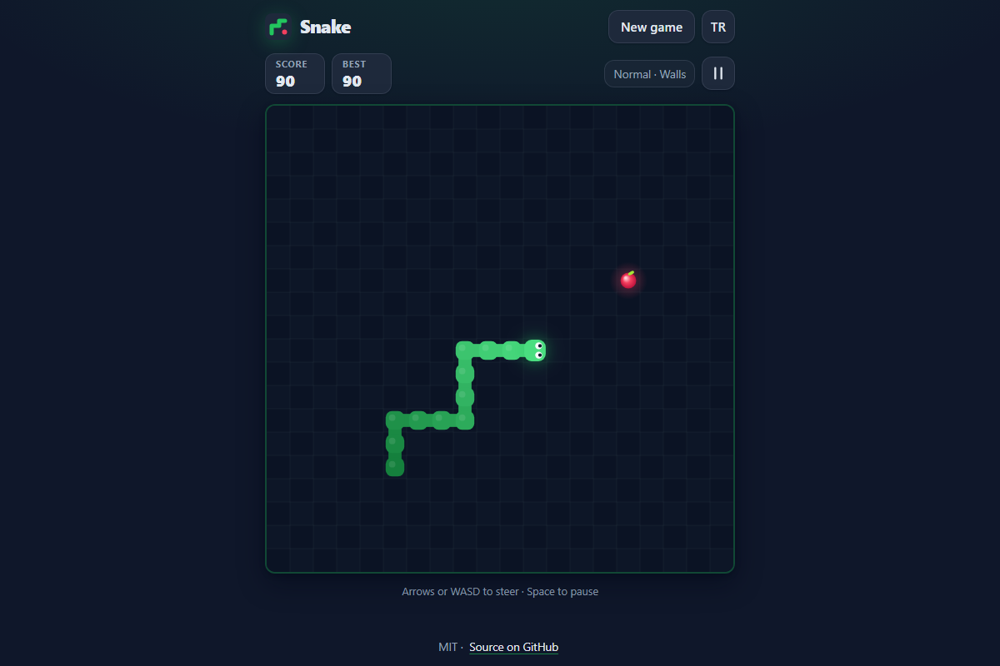

# Snake - the classic grow-and-don't-bite-yourself game, right in your browser

[](#tests)
[](LICENSE)

**▶ Play now: https://celaldrg.github.io/snake/**



## Features

- Classic grid Snake on a 20 × 20 board: eat food, grow by one, don't run into yourself.
- Two edge modes: **Walls** (the edge kills) or **Wrap** (leave one side, come back on the other).
- Four speed levels - Slow, Normal, Fast and Insane - with bonus points per food at higher speeds.
- Best score saved per speed level (in your browser's local storage; private mode is fine too).
- Responsive turns: up to two buffered turns per tick, and instant 180° reversals are ignored.
- Keyboard on desktop; swipes and an on-screen arrow pad on touch devices.
- English and Turkish UI, switchable at any time.
- No dependencies, no build step, no trackers: plain HTML, CSS and JavaScript modules.

## How to play

Steer the snake to the food. Each bite makes it one cell longer. The game ends when you hit a wall (in Walls mode) or your own body. Fill the whole board to win.

**Keyboard**

| Key | Action |
| --- | --- |
| Arrow keys or W A S D | Steer (also starts the game) |
| Space or P | Pause / resume |
| Enter | Play / play again |

**Touch**

- Swipe on the board (about 24 px is enough) - each swipe is one turn.
- Or use the arrow pad below the board.
- Use the pause button above the board to take a break.

## Run locally

Any static file server works. ES modules need `http://`, so opening `index.html` straight from disk (`file://`) will not work.

```bash
npx serve .
# then open the address it prints, e.g. http://localhost:3000
```

## Tests

```bash
node --test
```

Node 22 or newer, no packages to install. The suite covers:

- **Self-collision ends the game** - running into your own body, a tight loop during play, and that a finished game ignores input.
- Wall collision on all four edges in Walls mode, wrapping on all four edges in Wrap mode.
- Eating: the snake grows by one, the score goes up (with the speed bonus) and new food never appears on the snake.
- Reverse input is ignored, two turns are buffered, and the snake may move into the cell its tail just left.
- Filling the board wins; timing, pause, seeded randomness and 60 random seeded games that keep the board consistent.
- The `?demo` position, best scores, preferences, safe storage (a throwing `localStorage` never crashes), keyboard/swipe mapping and the English/Turkish string tables.

## Project structure

```
index.html            page markup and metadata
style.css             dark theme, layout, overlays
src/
  game.js             rules: movement, turns, food, collisions, win (no DOM)
  rng.js              seeded random numbers
  speed.js            speed levels and points
  scores.js           best score per speed level
  prefs.js            saved language, speed and edge mode
  storage.js          localStorage wrapper that never throws
  i18n.js             English and Turkish strings
  input.js            key and swipe mapping (no DOM)
  demo.js             fixed mid-game position for ?demo
  render.js           canvas drawing
  controls.js         keyboard, swipe and arrow-pad wiring
  main.js             app entry: overlays, HUD, game loop
test/                 node:test suites
docs/screenshot.png   README screenshot (?demo)
```

## License

[MIT](LICENSE) © 2026 Celalettin Durgaç

---

## Türkçe

Snake (Yılan) - büyü, kendini ısırma: klasik yılan oyunu doğrudan tarayıcında.

**▶ Hemen oyna: https://celaldrg.github.io/snake/**

### Özellikler

- 20 × 20 tahtada klasik yılan: yemi ye, bir hücre uza, kendine çarpma.
- İki kenar modu: **Duvarlı** (kenara çarpınca oyun biter) veya **Geçişli** (bir kenardan çıkıp karşı kenardan girersin).
- Dört hız seviyesi - Yavaş, Normal, Hızlı ve Çılgın - hızlı seviyelerde yem başına bonus puan.
- Her hız seviyesi için en iyi skor tarayıcıda saklanır (gizli modda da sorunsuz çalışır).
- Akıcı dönüşler: tur başına en fazla iki dönüş sıraya alınır, anında 180° geri dönüş yok sayılır.
- Masaüstünde klavye; dokunmatik cihazlarda kaydırma ve ekrandaki yön tuşları.
- İngilizce ve Türkçe arayüz, istediğin an değiştirilebilir.
- Bağımlılık yok, derleme adımı yok, izleyici yok: sade HTML, CSS ve JavaScript modülleri.

### Nasıl oynanır

Yılanı yeme doğru yönlendir. Her lokma onu bir hücre uzatır. Duvara (Duvarlı modda) ya da kendi gövdene çarparsan oyun biter. Tüm tahtayı doldurursan kazanırsın.

**Klavye**

| Tuş | İşlev |
| --- | --- |
| Yön tuşları veya W A S D | Yönlendir (oyunu da başlatır) |
| Boşluk veya P | Duraklat / devam et |
| Enter | Oyna / tekrar oyna |

**Dokunmatik**

- Tahtada kaydır (yaklaşık 24 piksel yeter) - her kaydırma bir dönüş.
- Ya da tahtanın altındaki yön tuşlarını kullan.
- Ara vermek için tahtanın üstündeki duraklat düğmesine dokun.

### Yerelde çalıştırma

Herhangi bir statik dosya sunucusu yeterli. ES modülleri `http://` ister; `index.html` dosyasını diskten (`file://`) doğrudan açmak çalışmaz.

```bash
npx serve .
# sonra yazdığı adresi aç, ör. http://localhost:3000
```

### Testler

```bash
node --test
```

Node 22 veya üstü yeterli, paket kurulumu gerekmez. Testler şunları kapsar:

- **Kendine çarpmak oyunu bitirir** - gövdeye çarpma, oyun sırasında sıkı bir döngü ve biten oyunun girdileri yok sayması.
- Duvarlı modda dört kenara çarpma, Geçişli modda dört kenardan geçiş.
- Yem yeme: yılan bir uzar, puan artar (hız bonusuyla) ve yeni yem asla yılanın üstünde çıkmaz.
- Ters yön girdisi yok sayılır, iki dönüş sıraya alınır, yılan kuyruğunun az önce boşalttığı hücreye girebilir.
- Tahtayı doldurmak kazandırır; zamanlama, duraklatma, tohumlu rastgelelik ve tahtayı tutarlı tutan 60 rastgele oyun.
- `?demo` konumu, en iyi skorlar, tercihler, güvenli depolama (hata fırlatan `localStorage` oyunu çökertmez), klavye/kaydırma eşlemesi ve İngilizce/Türkçe metin tabloları.

### Lisans

[MIT](LICENSE) © 2026 Celalettin Durgaç
